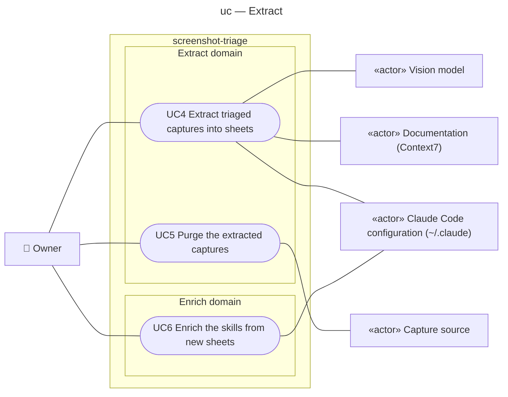

# Use case diagram — extract — from triaged captures to skill knowledge

> **Feature**: epic #1 — [Screenshot triage pipeline](https://github.com/benoit-bremaud/screenshot-triage/issues/1), brick #4
> **Source specs**: `docs/architecture/specs/extract-requirements.md`
> **Related ADRs**: ADR-0001 (decisions 7, 8, 9), ADR-0002, ADR-0003
> **See also**: `02-sequence-extract-batch.md` (SEQ-extract-batch), `02-sequence-enrichment-pr.md` (SEQ-enrichment-pr), `03-component.md`, `06-data-flow.md`, `../triage/05-state-capture.md`

## Context

Phase 0 of brick 4: the goals the owner reaches once captures are triaged. The subject is the product, CLI and `/screenshots` skill together. The Claude Code session plays two supporting roles here: the vision model that writes the sheet payload, and the verifier that queries Context7 or reads the target skill. `~/.claude` is a supporting actor because the subject proposes a PR there and does not control its merge.

## Diagram

## Actors

| Id | Label | Kind | Goals |
|---|---|---|---|
| `Owner` | Owner | primary, human | UC4, UC5, UC6 |
| `Source` | Capture source (local directory, Immich from brick 3) | supporting, system | receives the trash requests of the purge |
| `Model` | Vision model, the Claude Code session (ADR-0002) | supporting, system | reads a triaged capture and writes the sheet payload |
| `Docs` | Documentation reached through Context7 or the official site | supporting, system | confirms, contradicts or ignores a technical rule |
| `Skills` | The owner's Claude Code configuration | supporting, system | holds the target skill a design rule is confronted with, and receives the field-notes PR |

## Use cases

### UC4 — Extract triaged captures into sheets (status: planned)

- **Level**: user goal
- **Primary actor**: Owner
- **Stakeholders & interests**: Owner — each triaged capture becomes a short, checked sheet; nothing private is published; skills — only verified or clearly flagged rules reach them.
- **Preconditions**: at least one capture is `triaged`.
- **Minimal guarantee**: no file is deleted (UC4 never deletes, REQ-3); a rejected payload leaves the row `triaged` and writes nothing.
- **Success guarantee**: each processed capture has a sheet `knowledge/<domain>/<id>.md`, a thumbnail when it is a design gem, and the status `extracted`.
- **Trigger**: the owner asks `/screenshots` to extract, usually right after a triage batch.

**Main success scenario**

1. Owner asks for the extraction of the triaged captures.
2. System lists the `triaged` captures with their local path, domain and tags (`status`).
3. Vision model reads one capture and drafts the title, summary, rules, justification, target skill and author handle.
4. Vision model verifies each rule: a technical rule against Context7 or the official documentation (verified, contradicted, not-found, with the evidence URL), a design rule against the target skill (consistent, in-tension).
5. System validates the payload, renders the sheet, writes the thumbnail if the capture is a design gem, and records `extracted`.
6. Steps 3–5 repeat for every triaged capture of the batch.
7. System reports the sheets written and the rules to confirm.

**Extensions**

- 3a. The capture's `domain` is `other`: the skill skips it; it stays `triaged` and UC3 reminds the owner after 90 days.
- 3b. The useful content cannot be stated without private text: the skill skips it and tells the owner, who corrects it (`file`) or answers `delete` through a later batch; nothing is written.
- 5a. The payload is invalid (schema, rule kind and status mismatch, length, control character, non-`https` evidence): system rejects it with the reason, writes nothing; the skill may retry once.
- 5b. The capture is already `extracted`: system rewrites the sheet and the thumbnail (correction before the purge).

**Business rules**: REQ-10 to REQ-13, NFR-1, NFR-4.

### UC5 — Purge the extracted captures (status: planned)

- **Level**: user goal
- **Primary actor**: Owner
- **Preconditions**: at least one capture is `extracted`.
- **Minimal guarantee**: nothing is deleted without the owner's confirmation; with `--dry-run` nothing changes and the effects are printed.
- **Success guarantee**: each extracted capture and each duplicate of it is `deleted`, its local file removed and its source asset trashed (restorable from the source trash).
- **Trigger**: the owner confirms the batch after reading the sheets.

**Main success scenario**

1. System prints the purge plan (`purge --dry-run`).
2. Owner confirms.
3. System deletes each extracted file, trashes its source asset, records `deleted`, then does the same for the duplicates of the purged captures.

**Extensions**

- 2a. Owner refuses or postpones: nothing changes; a sheet can be corrected with UC4 ext. 5b.
- 3a. A source call fails: the row stays `extracted` with the error, the purge continues, a re-run completes it (a ref already gone is a no-op).

**Business rules**: REQ-3, REQ-6, REQ-14.

### UC6 — Enrich the skills from new sheets (status: planned)

- **Level**: user goal
- **Primary actor**: Owner
- **Preconditions**: sheets exist whose id is not cited in their target skill's field notes; no field-notes PR is pending in `~/.claude`.
- **Success guarantee**: one PR in `~/.claude` appends the new rules to each target skill's `references/field-notes.md`, split into adopted and to confirm, each citing its sheet by URL, and lists the new-skill candidates.
- **Trigger**: the owner asks `/screenshots` to enrich the skills, usually after a purge.

**Main success scenario**

1. System returns the uncited rules per target skill and the new-skill candidates (`notes`).
2. Skill drafts the field-notes changes and shows them to the owner.
3. Owner approves.
4. Skill commits them on a branch of `~/.claude` and opens the PR (procedures of `~/.claude`).

**Extensions**

- 1a. Nothing is uncited: system reports it; end.
- 3a. Owner drops a rule: it is left out of the PR and stays uncited, so `notes` proposes it again until the owner removes or corrects the sheet.

**Business rules**: REQ-15, NFR-4.

## Notes

- Only UC5 deletes; UC4 and UC6 never do (CLAUDE.md invariant).
- "Receive a contradicted rule" is not a use case; the owner sees it in the UC4 report and in the `to confirm` section of UC6.
