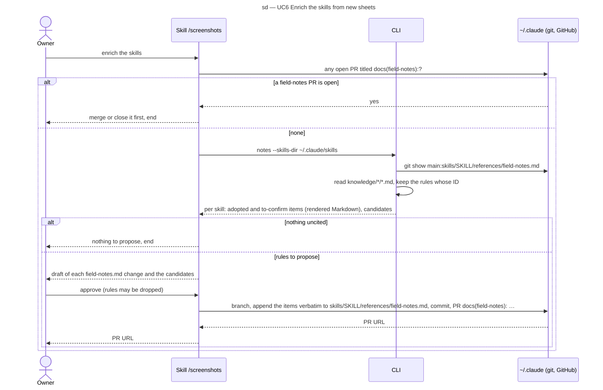

# Sequence diagram — extract — the enrichment PR (SEQ-enrichment-pr)

> **Feature**: epic #1, brick #4
> **Source specs**: `docs/architecture/specs/extract-requirements.md` (REQ-15, NFR-4)
> **Related ADRs**: ADR-0001 (decision 8), ADR-0003 (decision 3)
> **Realises**: UC6 · **See also**: `01-use-case.md`, `02-sequence-extract-batch.md`

## Context

UC6: the skill turns the uncited rules into one PR of `~/.claude` (a private repository). The CLI only reads and renders; the session writes the rendered items verbatim, after the owner's approval, under the PR and shared-tree procedures of that repository (`branch-scope.sh`).

## Diagram

## Notes

- A field-notes item cites `<id>#<n>` with the URL of `knowledge/<domain>/<id>.md` on `main` of the public repository, which is how `notes` detects it (ADR-0003 decision 3); the sheets are merged before UC6 runs.
- A target skill without `references/field-notes.md` is created by the PR, with the opening line of ADR-0003 (observations, not instructions).
- The PR is drafted on Opus (ADR-0001 § Models) and approved by the owner; the session never merges it.
