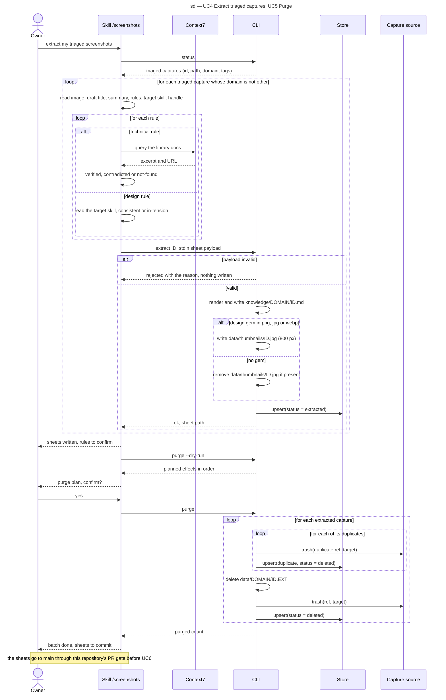

# Sequence diagram — extract — one extraction batch and its purge (SEQ-extract-batch)

> **Feature**: epic #1, brick #4
> **Source specs**: `docs/architecture/specs/extract-requirements.md` (REQ-10 to REQ-14, REQ-17)
> **Related ADRs**: ADR-0001 (decisions 7, 9), ADR-0003 (decisions 1, 2)
> **Realises**: UC4, UC5 · **See also**: `01-use-case.md`, `03-component.md`, `../triage/05-state-capture.md`

## Context

UC4 then UC5 in one conversation. The skill runs in the Claude Code session, which is also the vision model and the verifier (self-messages of the Skill lifeline); Context7 is reached through the session's MCP tools.

## Diagram

## Notes

- **Effect order of `extract`**: sheet file, thumbnail, index row; a crash before the row leaves `triaged` and a re-run rewrites the same files (idempotent); `--dry-run` prints them.
- **Effect order of `purge`** per original: its duplicates (source trash, row), then local delete, source trash, the original's row last; a crash leaves the original `extracted`, so the re-run finds its remaining duplicates and treats a missing local file and a ref already gone as done (REQ-14, UC5 ext. 3a; same order as `resolve`, `src/triage/transition.ts`).
- `status` lists the triaged captures (REQ-17).
- The skill never writes into `knowledge/` itself and never passes free text on argv (ADR-0002, ADR-0003).
- Bound of the loops: the triaged captures of the index; the skill may stop after any capture, the rest stays `triaged`.
