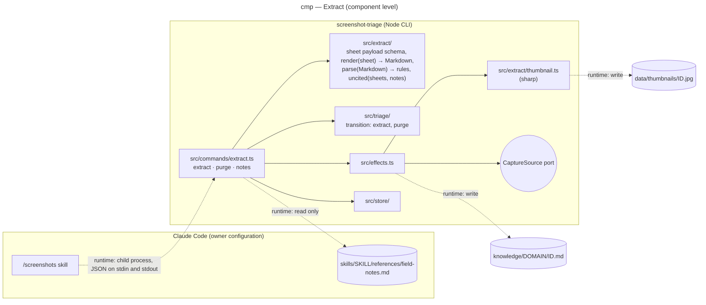

# Component diagram — extract — where brick 4 plugs into the CLI

> **Feature**: epic #1, brick #4
> **Related ADRs**: ADR-0002, ADR-0003
> **Realises**: UC4, UC5, UC6 · **See also**: `../triage/03-component.md` (the rest of the CLI)

## Context

Brick 4 adds one package, `src/extract/`, and three commands; it reuses the store, the effect runner and the `CaptureSource` port of brick 2. Only the new and the touched components are drawn.

## Diagram

## Notes

- `src/extract/` is pure (schema, renderer, parser, uncited filter) and imports neither `src/sources/` nor `sharp`; the thumbnail is an effect run by `src/effects.ts` through `thumbnail.ts`, so tests of the renderer need no image library.
- The new transitions (`triaged → extracted`, `extracted → extracted`, `extracted → deleted`, `duplicate → deleted` after the original's purge) are rows of the existing table in `src/triage/`, as `05-state-capture.md` already draws them.
- `notes` is the only code that reads outside the repository and `data/`; it reads one fixed path per skill and never writes there.
