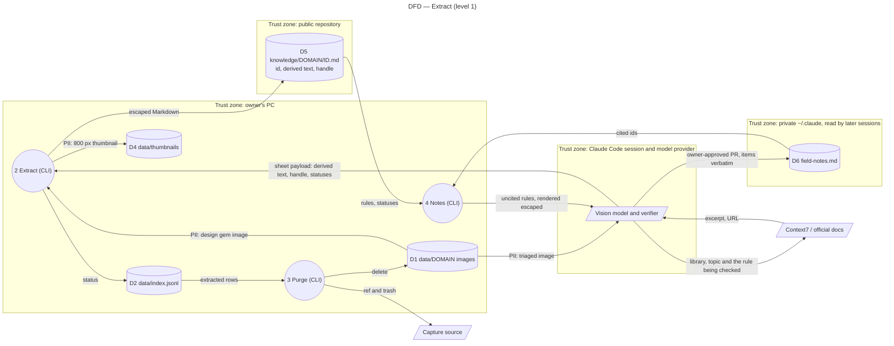

# Data flow diagram — extract — what the sheets and field notes publish

> **Feature**: epic #1, brick #4
> **Related ADRs**: ADR-0003; global rule ADR-0005 of `~/.claude` (public repositories by default)
> **Realises**: REQ-12, NFR-1, NFR-4 · **See also**: `../triage/06-data-flow.md`

## Context

Brick 4 is where derived text leaves the PC: into the public sheets of this repository, then into the private `~/.claude` repository as field notes read by later sessions. Process and store numbers continue `../triage/06-data-flow.md` (P1 triage, D3 decision log). Not native UML; drawn as a flowchart.

## Diagram

## Notes

- **D5 is published, D6 is read by every later session**: derived text and the author's handle only, escaped by the CLI renderer (NFR-4); no ref, filename, asset id or OCR dump (REQ-12). The owner reads every sheet before the purge (UC5) and its PR, and every field-notes PR before it opens (UC6).
- **To Context7** go the library, the topic and the rule being checked, never other screenshot text.
- **D4 thumbnails** stay git-ignored like D1: third-party images.
- Residual risk: an injected instruction in a screenshot reaching a skill as a rule; mitigated by escaping, length limits, the opening line of field-notes files and owner review (ADR-0003).
