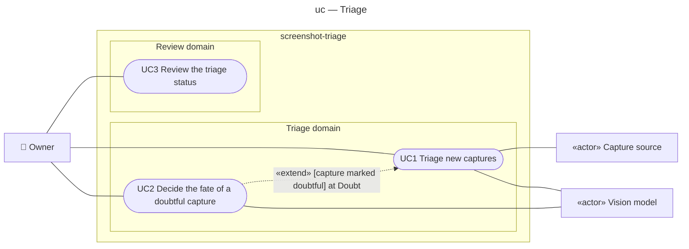

# Use case diagram — triage — who wants what from the triage step

> **Feature**: epic #1 — [Screenshot triage pipeline](https://github.com/benoit-bremaud/screenshot-triage/issues/1), brick #2
> **Related ADRs**: ADR-0001 (decisions 1, 5, 6, 7), ADR-0002 (classification by the Claude Code session)
> **See also**: `02-sequence-triage-batch.md`, `02-sequence-resolve-doubt.md`, `03-component.md`, `05-state-capture.md`

## Context

Phase 0 of brick 2: the goals the owner reaches through the triage step, before any extraction (brick 4). The subject is the whole product, CLI and `/screenshots` skill together; the vision model is the Claude Code session itself (ADR-0002), drawn as a supporting actor because the subject does not control it. Extraction, enrichment and the Immich adapter are out of scope here.

## Diagram

## Actors

| Id | Label | Kind | Goals |
|---|---|---|---|
| `Owner` | Owner — the person whose phone takes the screenshots | primary, human | UC1, UC2, UC3 |
| `Source` | Capture source — a local directory in brick 2, the Immich server from brick 3 | supporting, system | provides the captures and, from brick 3, their OCR text; receives album moves and trash requests |
| `Model` | Vision model — the Claude Code session running `/screenshots` (ADR-0002) | supporting, system | classifies a capture into a domain and tags, or declares a doubt, with its reasoning |

## Use cases

### UC1 — Triage new captures (status: planned)

- **Level**: user goal
- **Primary actor**: Owner
- **Stakeholders & interests**: Owner — every new capture lands in the right domain folder with reusable tags, nothing is deleted at this step; future skills (brick 4) — tags and domains are consistent; brick 6 — every decision is logged with its reasoning.
- **Preconditions**: the source is reachable; the data folder and the index exist (created on first run).
- **Minimal guarantee**: no capture is lost or deleted; a capture that could not be classified stays in the inbox with status `inbox` or `doubtful`.
- **Success guarantee**: every new capture has a row in the index with status `triaged`, `doubtful` or `duplicate`; triaged files sit under `data/<domain>/`; every classification is appended to the decision log.
- **Trigger**: the owner runs `/screenshots` (or the CLI `scan` then `file` commands).

**Main success scenario**

1. Owner asks for a triage.
2. System lists the captures of the source not yet in the index, computes their content hash and copies the new ones into the inbox.
3. System presents each inbox capture (image, OCR text when the source has it) with the domain list and the current tag list.
4. Vision model returns a domain, tags (reused before created), a confidence and a two-to-three-sentence reasoning.
5. System moves the file into the domain folder, records the row with status `triaged` and appends the decision to the log.
6. Steps 3–5 repeat for every inbox capture.
7. System reports the batch: counts per domain, new tags, doubtful captures.

**Extensions**

- 2a. The content hash is already in the index: system records the capture as `duplicate` without presenting it; resumes at 6.
- 4a. The vision model declares a doubt (personal content, unreadable, not dev or design veille): system records the row as `doubtful`, appends the reasoning to the log and moves on; the batch continues; **extension point "Doubt"** → UC2 after the batch.
- 4b. The vision model proposes a tag absent from the list: system accepts it only if no existing tag covers it (the model must say which existing tags it considered); the new tag is listed in the report.
- 5a. The file move fails: the row stays `inbox` with the error; the batch continues.

**Relationships**: extended by UC2 at "Doubt".
**Business rules**: REQ-1 (fixed domains), REQ-2 (tags reused before created), REQ-3 (no deletion on triage), REQ-4 (decision log), NFR-1 (no image in Git).

### UC2 — Decide the fate of a doubtful capture (status: planned)

- **Level**: user goal
- **Primary actor**: Owner
- **Stakeholders & interests**: Owner — personal captures are never read or summarised; a wrong "delete" is recoverable while the source trash keeps the asset.
- **Preconditions**: at least one capture has status `doubtful`.
- **Minimal guarantee**: nothing changes until the owner answers; with `--dry-run` nothing changes at all and the planned effects are printed.
- **Success guarantee**: the capture has a final or triaged status consistent with the answer, the local file reflects it, the source has been told (brick 3), the decision log holds the answer.
- **Trigger**: the owner answers the question asked after a triage batch, or runs the CLI `resolve` command.

**Main success scenario**

1. System presents one doubtful capture with the model's reasoning and the three answers: work, personal, delete.
2. Owner answers.
3. System applies the answer (see extensions 3a–3c) and appends it to the decision log.
4. Steps 1–3 repeat for every doubtful capture.

**Extensions**

- 3a. Answer is **work**: system asks the vision model for a classification with doubt disallowed, then continues as UC1 step 5.
- 3b. Answer is **personal**: system deletes the local file without reading it further, asks the source to move the asset to the personal album (brick 3; no-op on a local directory), records status `personal`.
- 3c. Answer is **delete**: system deletes the local file, asks the source to trash the asset (brick 3; no-op on a local directory), records status `deleted`.
- 3d. `--dry-run` is set: system prints the effects of 3a–3c and changes nothing.
- *a. Owner postpones: the capture stays `doubtful` and is listed by UC3.

**Relationships**: extends UC1 at "Doubt".
**Business rules**: REQ-3, REQ-4, REQ-5 (personal captures never read), REQ-6 (`--dry-run` on every destructive command).

### UC3 — Review the triage status (status: planned)

- **Level**: user goal, brief: the owner runs `status` and reads counts per status and domain, the doubtful captures awaiting an answer, the tags with their capture counts (a tag at five captures without a covering skill is flagged as a new-skill candidate, ADR-0001 § Taxonomy), and the `other` captures older than 90 days.
- **Business rules**: REQ-7 (reminder for `other` after 90 days).

## Notes

- Deletion never appears in UC1: it is a UC2 effect (owner answer) or a brick 4 effect (final status after the sheet). Reviewers should check that no step of UC1 removes a file.
- "Receive the doubt question" is not a use case; the owner's goal is UC2.
- Open question for brick 3: whether a personal answer also removes the asset from the Screenshots album (the album move may suffice).
