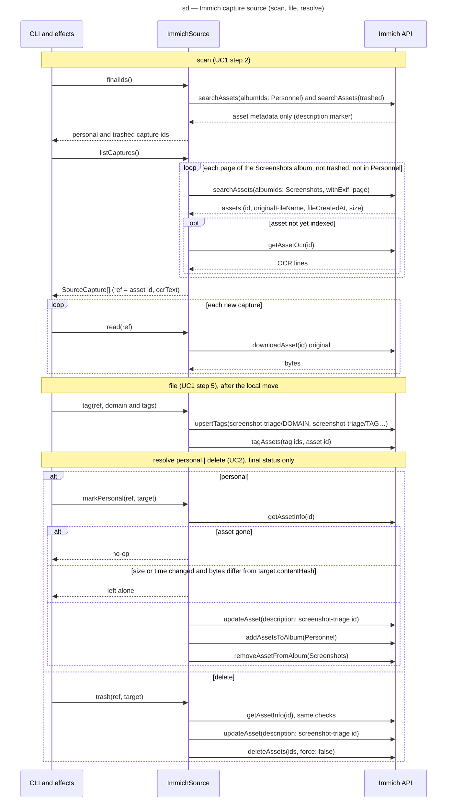

# Sequence diagram — triage — the Immich capture source (SEQ-immich-source)

> **Feature**: epic #1, brick #3
> **Source specs**: `docs/architecture/specs/triage-requirements.md` (REQ-3, REQ-5, REQ-6, REQ-10)
> **Related ADRs**: ADR-0001 (decisions 3, 4), ADR-0002
> **Realises**: UC1, UC2 · **See also**: `02-sequence-triage-batch.md`, `02-sequence-resolve-doubt.md`, `03-component.md`

## Context

How `src/sources/immich.ts` realises the `CaptureSource` port against the Immich API through `@immich/sdk`. The Effects lifeline stands for `src/effects.ts` driven by `scan`, `file` and `resolve`; the adapter is the only lifeline that talks HTTPS. The API key comes from `.env` (`IMMICH_URL`, `IMMICH_API_KEY`), scoped to asset read, download, update and delete, album read and update, tag create and asset tagging; never the trash-empty permission. The albums are named by `IMMICH_ALBUM` (default `Screenshots`) and `IMMICH_PERSONAL_ALBUM` (default `Personnel`); the CLI pins `immich:<url>#<album id>` in `data/source.json` like a local root.

## Diagram

## Notes

- **Content of a personal asset is never read**: `finalIds()` reads album and trash membership and the description marker written by the adapter itself, never the bytes or the OCR text of an asset in `Personnel` or in the trash (REQ-5).
- **Why a marker**: the guards compare capture ids (SHA-256 prefix); Immich only knows its own SHA-1 checksum. Writing `screenshot-triage:<id>` into the description on a final status lets `finalIds()` answer without the index and without reading bytes, as the `<id>.<ext>` names do on the local source.
- **Trash, never purge**: `deleteAssets` is always called with `force: false`; the key has no trash-empty permission. A restored asset keeps its ref and comes back into the album listing, so `scan` triages it again (its row was `deleted`).
- **Tags** live under a `screenshot-triage/` parent tag, domain first; on the local source `tag()` is a no-op. A tag failure does not undo the filing: the row is already `triaged`, the next `file` (correction) re-tags.
- **Listing scope**: the full Screenshots album is listed on every scan, metadata only; `scan` skips the refs already indexed before any download or OCR call, so only new assets cost a download.
- **Errors**: an HTTP error during `listCaptures` or `read` aborts the scan before any write for that capture (exit 3); a 404 on a final-status call is the "ref already gone" no-op.
- **Dry run**: `--dry-run` prints `source.tag`, `source.markPersonal` and `source.trash` without calling the API (REQ-6).
