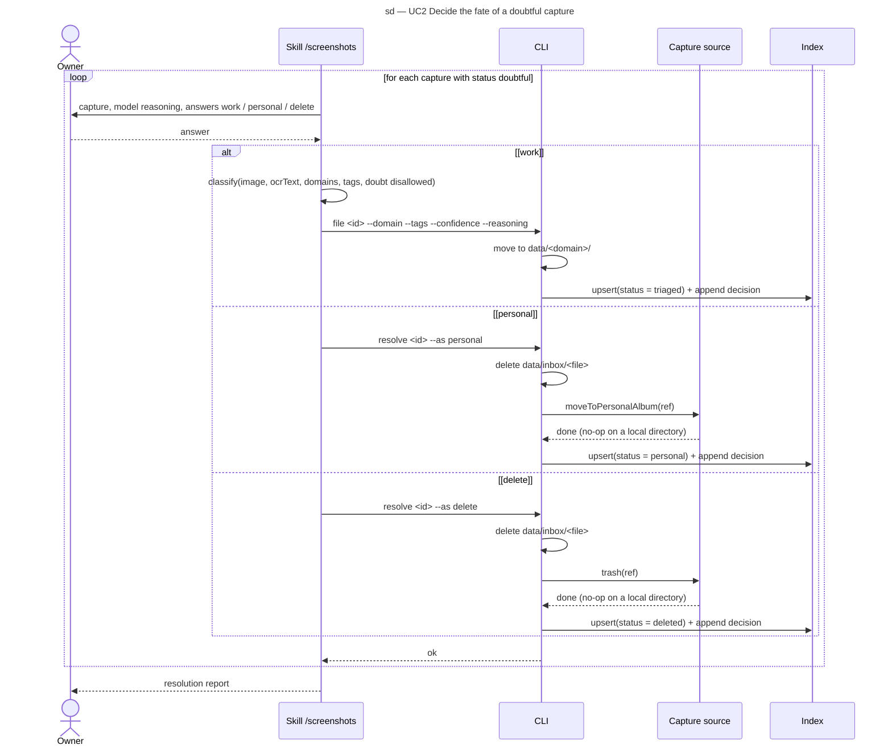

# Sequence diagram — triage — resolving a doubtful capture

> **Feature**: epic #1, brick #2
> **Related ADRs**: ADR-0001 (decision 7), ADR-0002
> **Realises**: UC2 · **See also**: `01-use-case.md`, `02-sequence-triage-batch.md`, `05-state-capture.md`

## Context

The three answers of UC2 and the dry-run variant. This is the only scenario of brick 2 that deletes a file. The source calls for album move and trash are no-ops on the local-directory source and become Immich API calls in brick 3; the contract is fixed here.

## Diagram

## Notes

- **Dry run**: `resolve --dry-run` prints the three effects (local delete, source call, index change) and returns before any of them (REQ-6). It is omitted from the diagram to keep the fragment readable; the test `T-7` covers it.
- **Personal captures are never read** (REQ-5): the personal branch carries no image or OCR text to the model; the only data that leaves the capture is its id and source ref.
- **Order of effects**: the local file is deleted before the source call so a source failure (brick 3, network) cannot leave a readable personal file on the PC; the index row records a source failure as a pending source action to retry on the next run.
- The `work` branch re-enters the UC1 flow with doubt disallowed: the model must choose a domain; `other` remains available.
- No branch here reaches the `extracted` status; that is brick 4.
