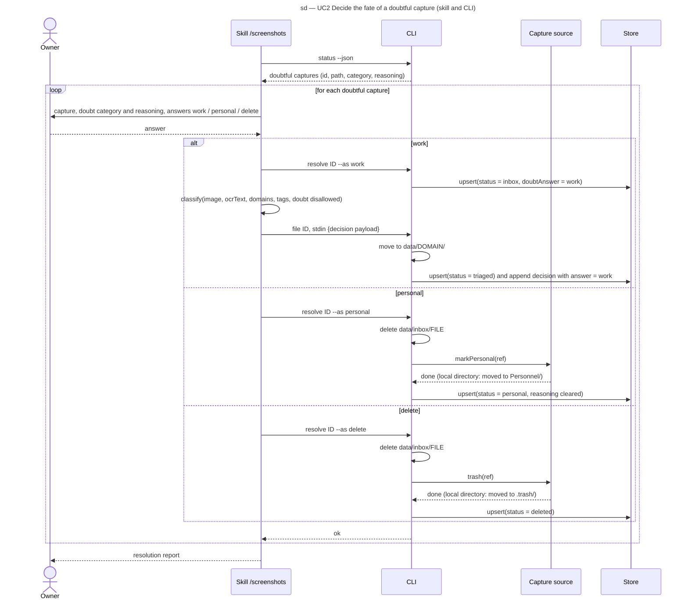

# Sequence diagram — triage — resolving a doubtful capture (SEQ-resolve-doubt)

> **Feature**: epic #1, brick #2
> **Source specs**: `docs/architecture/specs/triage-requirements.md` (REQ-3 to REQ-6)
> **Related ADRs**: ADR-0001 (decision 7), ADR-0002
> **Realises**: UC2 · **See also**: `01-use-case.md`, `02-sequence-triage-batch.md`, `05-state-capture.md`, `06-data-flow.md`

## Context

The three answers of UC2. This is the only scenario of brick 2 that deletes a file. The source calls for the personal mark and the trash are real on every source: subfolders `Personnel/` and `.trash/` skipped by `listCaptures` on the local directory, the `Personnel` album and the trash on Immich (brick 3). The source, not the index, is the durable record of personal and deleted captures (ADR-0002).

## Diagram

## Notes

- **Dry run**: `resolve --as personal|delete --dry-run` prints the effects in order (local delete, source call, index change) and returns before any of them (REQ-6); `--as work` has no destructive effect and ignores the flag. Test T-7.
- **Personal captures are never read** (REQ-5): the personal branch carries no image or OCR text to the model; the doubt reasoning is cleared from the index row and never reached the versioned log; the only data that leaves the capture is its ref, sent to the source.
- **Order of effects**: the local file is deleted before the source call so a source failure (brick 3, network) cannot leave a readable personal file on the PC. Delete is idempotent, so a crash before the index write is repaired by running `resolve` again. Retrying a failed source call is designed in brick 3; on the local directory the source call is a move inside the same file system.
- **Losing `data/` is safe**: a fresh `scan` lists neither `Personnel/` nor `.trash/`, so personal captures never come back (T-14).
- The `work` branch records the owner's answer first (`Doubtful → Inbox`), then re-enters the UC1 flow with doubt disallowed; the decision log entry carries `answer: work`, the label brick 6 values most.
- Doubtful files stay in `data/inbox/`; `status` and `resolve` select by index status, never by folder.
