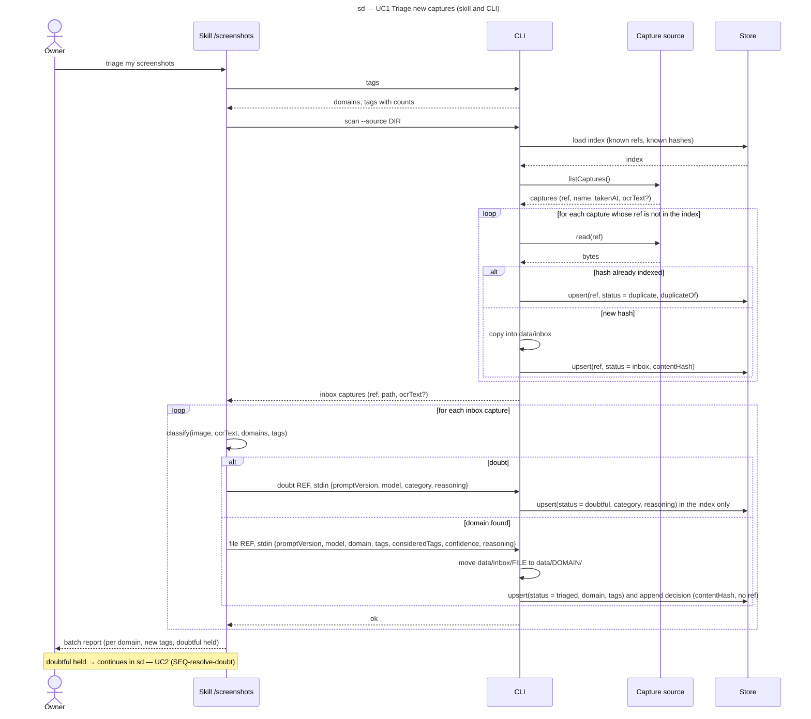

# Sequence diagram — triage — one triage batch (SEQ-triage-batch)

> **Feature**: epic #1, brick #2
> **Source specs**: `docs/architecture/specs/triage-requirements.md` (REQ-1 to REQ-5)
> **Related ADRs**: ADR-0001 (decisions 5, 6), ADR-0002
> **Realises**: UC1 · **See also**: `01-use-case.md`, `02-sequence-resolve-doubt.md`, `03-component.md`, `05-state-capture.md`

## Context

The nominal scenario of UC1 with its two branches (duplicate, doubt). The `/screenshots` skill runs inside the Claude Code session, which is also the vision model (ADR-0002): classification is a self-message of the Skill lifeline. The CLI lifeline stands for `src/cli.ts`; Source and Store are the components of `03-component.md`. The resolution of doubtful captures is `02-sequence-resolve-doubt.md`.

## Diagram

## Notes

- **No deletion anywhere** on this diagram (REQ-3); a duplicate keeps its index row only, the duplicate file is not copied.
- **Two keys** (glossary): `ref` identifies a capture in the index and in every command; `contentHash` detects duplicates and identifies a capture in the versioned decision log, so no filename reaches Git (REQ-5, NFR-1).
- **Free text never travels through argv**: the decision payload is one JSON object on stdin, validated against one schema in `src/triage/` (ADR-0002). A doubt payload is stored in the git-ignored index only; the versioned decision log receives `file` decisions only (REQ-4).
- The tag list comes from `tags` once per batch and travels with every classification request so the model reuses before creating (REQ-2); a new tag comes with `consideredTags`.
- Bound of the loops: the number of captures returned by `listCaptures()`; large backlogs (brick 5) are fed in batches of 20–30 by the source.
- A failed move (UC1 ext. 5a) leaves the row at `inbox`; the next `scan` presents it again. Move and copy are idempotent so a crash between an effect and the index write is repaired by the next `scan`.
- The OCR text is optional: absent on a local directory (brick 2), present with Immich (brick 3).
