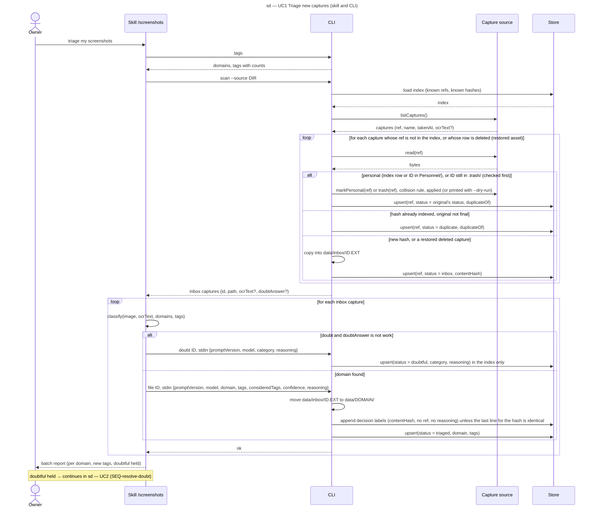

# Sequence diagram — triage — one triage batch (SEQ-triage-batch)

> **Feature**: epic #1, brick #2
> **Source specs**: `docs/architecture/specs/triage-requirements.md` (REQ-1 to REQ-5)
> **Related ADRs**: ADR-0001 (decisions 5, 6), ADR-0002
> **Realises**: UC1 · **See also**: `01-use-case.md`, `02-sequence-resolve-doubt.md`, `03-component.md`, `05-state-capture.md`

## Context

The nominal scenario of UC1 with its two branches (duplicate, doubt). The `/screenshots` skill runs inside the Claude Code session, which is also the vision model (ADR-0002): classification is a self-message of the Skill lifeline. The CLI lifeline stands for `src/cli.ts`; Source and Store are the components of `03-component.md`. The resolution of doubtful captures is `02-sequence-resolve-doubt.md`.

## Diagram

## Notes

- **No deletion of a work capture** on this diagram (REQ-3); a duplicate keeps its index row only, the duplicate file is not copied. The one source action here settles a copy of a capture already personal or deleted, so a phone re-sync never resurfaces it, even after `data/` is lost, because the personal guard also reads the ids in `Personnel/` (content never read, ids only), while a deleted copy is re-trashed only while its id is still in `.trash/`, so a restored file is triaged again; `scan --dry-run` changes nothing and prints every effect (REQ-6, `05-state-capture.md`, T-7, T-14).
- **The log holds labels only**: the reasoning of a filing stays in the index row (Codex P1 on PR #7: a false-negative `work` filing must not publish text echoed from a personal screenshot). On Immich a restored asset keeps its ref, so the loop also revisits refs whose row is `deleted`; on the local source a restored file is a new ref.
- **Three identifiers** (glossary): `ref` is the index row key and the only name the source knows; `contentHash` detects duplicates and identifies a capture in the versioned decision log, so no filename reaches Git (REQ-5, NFR-1); `id`, its first 12 hex characters, is what every command takes on argv, so an attacker-controlled filename never reaches a shell command built by the session.
- **A capture kept as work is never doubted again**: `scan` returns `doubtAnswer` and the CLI rejects `doubt` on a row whose `doubtAnswer` is `work` (T-10).
- **Free text never travels through argv**: the decision payload is one JSON object on stdin, validated against one schema in `src/triage/` (ADR-0002). A doubt payload is stored in the git-ignored index only; the versioned decision log receives `file` decisions only (REQ-4).
- The tag list comes from `tags` once per batch and travels with every classification request so the model reuses before creating (REQ-2); a new tag comes with `consideredTags`.
- Bound of the loops: the number of captures returned by `listCaptures()`; large backlogs (brick 5) are fed in batches of 20–30 by the source.
- A failed move (UC1 ext. 5a) leaves the row at `inbox`; the next `scan` presents it again. Effect order inside `file`: move, log append (skipped only when the last line for that hash is identical field for field), index write; a crash leaves the row `inbox`, `scan` finds the file by `<id>.<ext>` in `data/inbox/` then in every domain folder, and re-running `file` completes the index write without a second log line, unless the session picks another domain, in which case brick 6 reads the last line per hash (ADR-0002).
- Local copies are named `<id>.<ext>`, the extension taken from the magic bytes against a whitelist, so the `path` returned to the session never carries any part of the source filename (REQ-9).
- The OCR text is optional: absent on a local directory (brick 2), present with Immich (brick 3).
