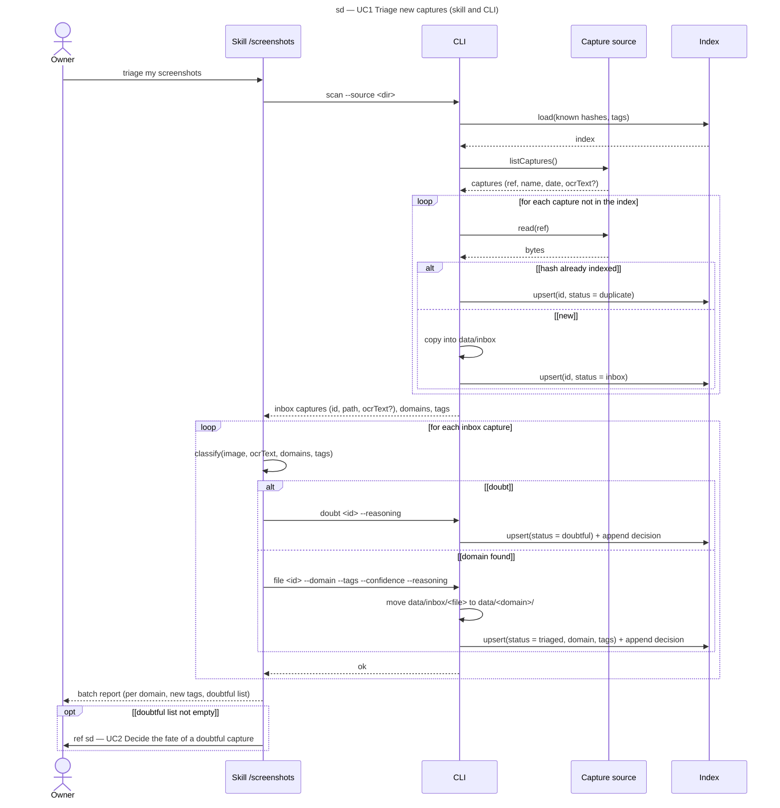

# Sequence diagram — triage — one triage batch

> **Feature**: epic #1, brick #2
> **Related ADRs**: ADR-0001 (decisions 5, 6), ADR-0002
> **Realises**: UC1 · **See also**: `01-use-case.md`, `02-sequence-resolve-doubt.md`, `03-component.md`, `05-state-capture.md`

## Context

The nominal scenario of UC1 with its two branches (duplicate, doubt). The `/screenshots` skill runs inside the Claude Code session, which is also the vision model (ADR-0002): classification is a self-message of the Skill lifeline. The CLI lifeline stands for `src/cli.ts`; Source and Index are the components of `03-component.md`. The resolution of doubtful captures is `02-sequence-resolve-doubt.md`.

## Diagram

## Notes

- **No deletion anywhere** on this diagram (REQ-3); a duplicate keeps its index row only, the duplicate file is not copied.
- The tag list travels with every classification request so the model reuses before creating (REQ-2); a new tag must come with the existing tags the model considered (UC1 ext. 4b).
- Every `file` and `doubt` call appends one line to the decision log with the prompt version, domain, tags, confidence and reasoning (REQ-4): this is the training material of brick 6.
- Bound of the loops: the number of captures returned by `listCaptures()`; a batch is processed in one session, large backlogs (brick 5) are fed in batches of 20–30 by the source.
- A failed move (UC1 ext. 5a) leaves the row at `inbox`; the next `scan` presents it again.
- The OCR text is optional: absent on a local directory (brick 2), present with Immich (brick 3).
