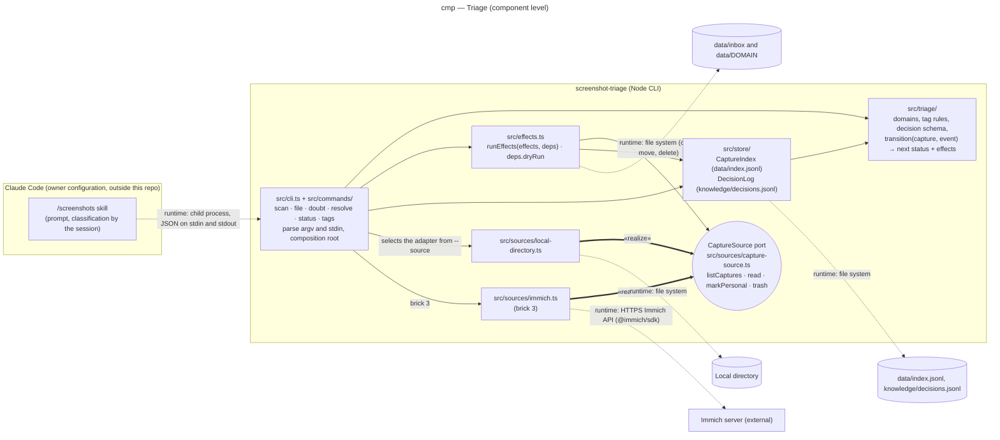

# Component diagram — triage — CLI, skill and sources

> **Feature**: epic #1, brick #2
> **Related ADRs**: ADR-0001 (decisions 4, 12, 13), ADR-0002
> **Realises**: UC1, UC2, UC3 · **See also**: `02-sequence-triage-batch.md`, `05-state-capture.md`

## Context

Component level inside the one container of this repository (a Node CLI), plus the `/screenshots` skill that lives in the owner's Claude Code configuration and the external capture sources. The diagram makes the dependency rule of `CLAUDE.md` visible: only `src/sources/` knows a source SDK; `src/triage/` and `src/store/` are pure. Solid arrows are compile-time dependencies pointing to the supplier; dashed arrows are runtime calls.

## Diagram

## Notes

- **Single egress per external**: the Immich server is reached only by `src/sources/immich.ts`; the local directory only by `src/sources/local-directory.ts`. A `@immich/sdk` import anywhere else is a defect (CLAUDE.md dependency rule), enforced by one `no-restricted-imports` lint rule (NFR-2).
- **The port is justified** by two implementations (local directory now, Immich in brick 3) and by the tests, which drive the CLI with the local source over a temporary directory. Contract: `listCaptures()` → `{ ref, name, takenAt, size, ocrText? }[]`, `read(ref)` → bytes, `markPersonal(ref, target)`, `trash(ref, target)` with `target = { localName, contentHash, size, takenAt }` (the `<id>.<ext>` name the source files the capture under; a ref already gone is a no-op; a file whose size or time changed is hashed, never interpreted, and moved only when its bytes are the scanned ones; the CLI records the source root in `data/source.json` on first use and refuses any other `--source`), `finalIds()` → the ids present in `Personnel/` and `.trash/` (Immich: album and trash membership), which the Personal and Deleted `scan` guards read. On the local source `markPersonal` and `trash` move the file into `Personnel/` and `.trash/` subfolders that `listCaptures` skips, renamed `<id>.<ext>` (a duplicate whose target exists is removed instead, the bytes being identical); on Immich they are the `Personnel` album and the trash. The source is the durable record of final statuses (ADR-0002, T-14). `ref` is relative to the directory on the local source and the asset id on Immich; commands take the `id` (12 hex characters of the content hash), never the ref.
- **Functional core, imperative shell**: `src/triage/` computes the next status and an ordered list of effects (copy, move, delete, source call, index write, log append) for an event; `src/effects.ts` runs them in order, file-system effects itself and store effects through `src/store/`, or, with `--dry-run`, prints them. The effect order of REQ-6, `02-sequence-resolve-doubt.md` and the `file` order of ADR-0002 is therefore written once; T-6 and T-7 test the pure function.
- **The skill owns the prompt**, the CLI owns the facts: the CLI never calls a model (ADR-0002). The skill reads the domain list and the current tags from `tags`, the only command that serves them.
- `src/triage/` imports nothing from `src/sources/`, `src/store/`, `src/effects.ts` or `src/commands/`; `src/store/` imports the status enum and the decision schema from `src/triage/`. `src/cli.ts` parses argv and wires the adapters; one module per command lives in `src/commands/` (`scan`, `decide` for `file` · `doubt` · `resolve`, `status` for `status` · `tags`).
- `knowledge/` is versioned (decision log, later the sheets); `data/` is git-ignored (index, inbox, domain folders, thumbnails; NFR-1).
