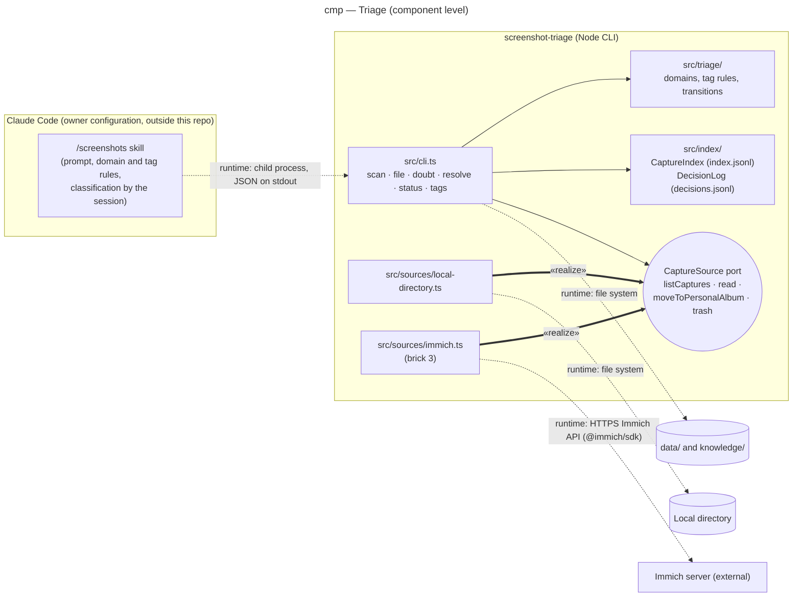

# Component diagram — triage — CLI, skill and sources

> **Feature**: epic #1, brick #2
> **Related ADRs**: ADR-0001 (decisions 4, 12, 13), ADR-0002
> **Realises**: UC1, UC2, UC3 · **See also**: `02-sequence-triage-batch.md`, `05-state-capture.md`

## Context

Component level inside the one container of this repository (a Node CLI), plus the `/screenshots` skill that lives in the owner's Claude Code configuration and the external capture sources. The diagram makes the dependency rule of `CLAUDE.md` visible: only `src/sources/` knows a source SDK; `src/triage/` and `src/index/` are pure. Arrows are compile-time dependencies pointing to the supplier; runtime calls are dashed.

## Diagram

## Notes

- **Single egress per external**: the Immich server is reached only by `src/sources/immich.ts`; the local directory only by `src/sources/local-directory.ts`. A `@immich/sdk` import anywhere else is a defect (CLAUDE.md dependency rule).
- **The port is justified** by two implementations (local directory now, Immich in brick 3) and by the tests, which drive the CLI with the local source or an in-memory fake. Its contract: `listCaptures()` → `{ ref, name, takenAt, ocrText? }[]`, `read(ref)` → bytes, `moveToPersonalAlbum(ref)`, `trash(ref)`; the last two are no-ops on the local source.
- **The skill owns the prompt**, the CLI owns the facts: the CLI never calls a model (ADR-0002). The skill reads the domain list and the current tags from `cli tags` so the two never drift.
- `src/triage/` holds the domain list, the tag normalisation (kebab-case English, reuse check) and the legal status transitions of `05-state-capture.md`; it imports nothing from `src/sources/` or `src/index/`.
- `knowledge/` is versioned (index, decision log, later the sheets); `data/` is git-ignored (NFR-1).
- Deployment is trivial (one machine, one process) and has no diagram; brick 3 may add one when Tailscale and the Pi enter the picture.
