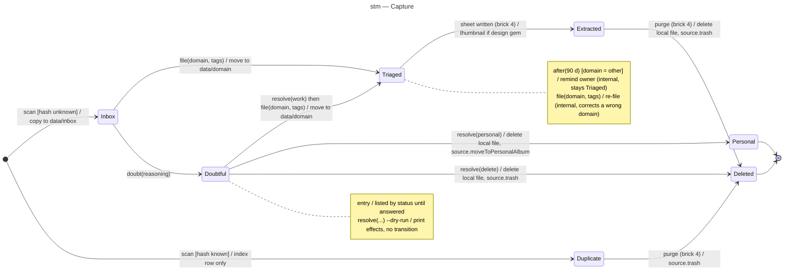

# State machine diagram — triage — Capture

> **Feature**: epic #1, brick #2 (statuses of bricks 4 and 6 included so the enum is final)
> **Related ADRs**: ADR-0001 (decision 7 and § Lifecycle)
> **Realises**: UC1, UC2 · **See also**: `02-sequence-triage-batch.md`, `02-sequence-resolve-doubt.md`

## Context

The lifecycle of one capture as recorded in `index.jsonl`. The state names are the values of the `status` enum in `src/triage/`; the diagram is the source of truth for the legal transitions and the code must refuse the others. Deletion is an effect of exactly three transitions, all reachable only from an owner answer or a written sheet (REQ-3).

## Diagram

## Transitions and tests

| From | Event [guard] | To | Effect | Test |
|---|---|---|---|---|
| — | `scan` [hash unknown] | Inbox | copy into `data/inbox/` | T-1 |
| — | `scan` [hash known] | Duplicate | index row only, no copy | T-2 |
| Inbox | `file(domain, tags)` | Triaged | move to `data/<domain>/`, decision logged | T-3 |
| Inbox | `doubt(reasoning)` | Doubtful | decision logged | T-4 |
| Doubtful | `resolve(work)` + `file` | Triaged | as T-3 | T-5 |
| Doubtful | `resolve(personal)` | Personal | local delete, source album move | T-6 |
| Doubtful | `resolve(delete)` | Deleted | local delete, source trash | T-6 |
| Doubtful | `resolve(*) --dry-run` | Doubtful | effects printed, nothing changed | T-7 |
| Triaged | `file(domain, tags)` | Triaged | re-file to another domain folder | T-8 |
| Triaged | `after(90 d)` [other] | Triaged | reminder in `status` | T-9 |
| any other (state, event) pair | — | unchanged | rejected with an explicit error | T-10 |
| Triaged | sheet written | Extracted | brick 4 | brick 4 |
| Extracted, Duplicate | purge | Deleted | brick 4 | brick 4 |

## Notes

- **Rejected events**: `resolve` on a non-doubtful capture, `file` on a deleted or personal capture, `doubt` on a triaged capture. The CLI exits non-zero with the current status; T-10 covers one of each.
- **Personal and Deleted are final** and never re-enter: a personal capture is never read again (REQ-5); a wrongly deleted asset is restored by the owner in the source trash, outside this tool.
- **Duplicate** is reached only from the initial pseudostate: the duplicate file is never copied, so there is nothing local to delete; its source asset is trashed at the brick 4 purge.
- The `Inbox → Inbox` case after a failed move (UC1 ext. 5a) is not a transition: the row keeps `inbox` with an `error` field and the next `scan` presents it again.
- Brick 6 reads the decision log only; it adds no state.
