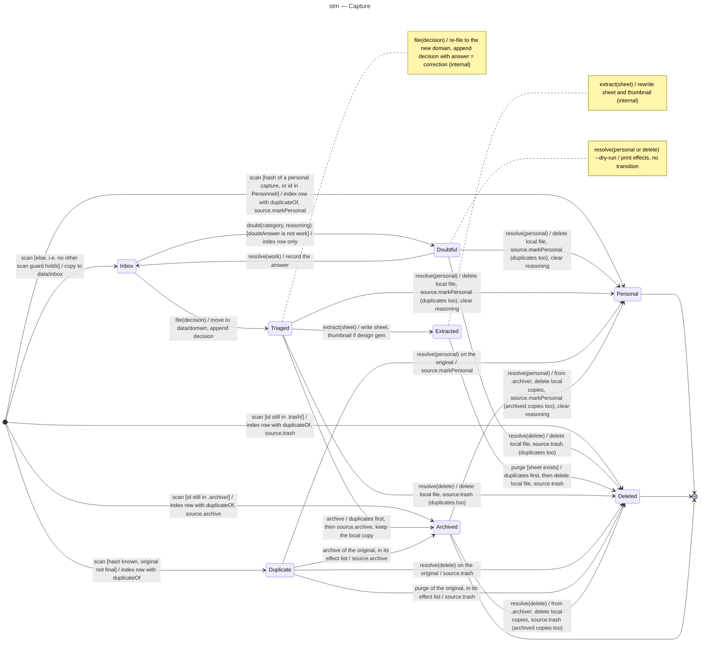

# State machine diagram — triage — Capture

> **Feature**: epic #1, brick #2 (brick 4 transitions specified in `../extract/`, ADR-0003)
> **Related ADRs**: ADR-0001 (decision 7 and § Lifecycle), ADR-0002, ADR-0004 (archive)
> **Realises**: UC1, UC2, UC4, UC5, UC7 · **See also**: `02-sequence-triage-batch.md`, `02-sequence-resolve-doubt.md`

## Context

The lifecycle of one capture as recorded in `data/index.jsonl`. The state names, lowercased, are the values of the `status` enum in `src/triage/`; the diagram is the source of truth for the legal transitions and the code must refuse the others. A capture leaves the source's camera roll through exactly five events: two owner answers (applied to the capture and its duplicates), the purge after a sheet, `archive` after triage (moved into the private `.archive/`, never deleted, ADR-0004), and `scan` meeting a copy of a capture already personal (index row or id in `Personnel/`), still in `.trash/` or still in `.archive/`, whose new copy follows that status at once. A sheet is removed only when a triaged capture is answered personal or delete, re-filed or archived, after a crashed `extract` left one.

## Diagram

## Transitions and tests

| From | Event [guard] | To | Effect | Test |
|---|---|---|---|---|
| — | `scan` [else: no other `scan` guard holds] | Inbox | copy into `data/inbox/`, row with `contentHash` (covers an unknown hash and a restored deleted capture) | T-1 |
| — | `scan` [hash known, original not final] | Duplicate | row with `duplicateOf`, no copy | T-2 |
| — | `scan` [hash of a personal capture, or id in `Personnel/`] | Personal | row with `duplicateOf`, `source.markPersonal` (collision rule) | T-14 |
| — | `scan` [id still in `.trash/`] | Deleted | row with `duplicateOf`, `source.trash` (collision rule) | T-14 |
| Inbox | `file(decision)` | Triaged | move to `data/<domain>/<id>.<ext>`, decision labels appended (skipped only on an identical log line, glossary), index row written with the reasoning, in that order | T-3 |
| Inbox | `doubt(category, reasoning)` [doubtAnswer ≠ work] | Doubtful | index row only, nothing appended to the log | T-4 |
| Doubtful | `resolve(work)` | Inbox | `doubtAnswer = work` on the row; the following `file` logs `answer = work` | T-5 |
| Doubtful | `resolve(personal)` | Personal | local delete, `source.markPersonal` of the capture and its duplicates, reasoning cleared | T-6, T-14 |
| Doubtful | `resolve(delete)` | Deleted | local delete, `source.trash` of the capture and its duplicates | T-6, T-14 |
| Doubtful | `resolve(personal or delete) --dry-run` | Doubtful | effects printed in order, nothing changed | T-7 |
| — | `scan --dry-run` | — | nothing changed: no copy, no row, every effect printed in order, the 2a source action included | T-7 |
| Triaged | `file(decision)` | Triaged | first remove a sheet and thumbnail left by a crashed `extract`, then re-file to another domain folder, decision appended with `answer = correction` | T-8, T-22 |
| any other (state, event) pair | — | unchanged | rejected with the current status, non-zero exit | T-10 |
| Triaged | `extract(sheet)` | Extracted | sheet `knowledge/<domain>/<id>.md`, thumbnail if design gem, index row, in that order | T-16, T-18 |
| Extracted | `extract(sheet)` | Extracted | sheet and thumbnail rewritten | T-16 |
| Extracted | `purge` (its sheet exists) | Deleted | duplicates first (`source.trash`, row), then local delete, `source.trash`, the original's row last; `--dry-run` prints them | T-19 |
| Triaged | `resolve(personal)` | Personal | first remove a sheet and thumbnail left by a crashed `extract`, then as from Doubtful (REQ-16) | T-22 |
| Triaged | `resolve(delete)` | Deleted | first remove a sheet and thumbnail left by a crashed `extract`, then as from Doubtful (REQ-16) | T-22 |
| Duplicate | `resolve(personal)` on the original | Personal | `source.markPersonal` (or removal from the source when `Personnel/<id>.<ext>` already holds the identical bytes) | T-14 |
| Duplicate | `resolve(delete)` on the original | Deleted | `source.trash` (same collision rule) | T-14 |
| Duplicate | `purge` of the original, in its effect list | Deleted | `source.trash`, index row, before the original's row | T-19 |
| Triaged | `archive` | Archived | first remove a sheet and thumbnail left by a crashed `extract`, then duplicates (`source.archive`, row), then `source.archive` of the original and its row last; local copy kept, nothing logged; `--dry-run` prints them | T-24 |
| Duplicate | `archive` of the original, in its effect list | Archived | `source.archive` (removal when `.archive/<id>.<ext>` already holds the identical bytes), index row, before the original's row | T-24 |
| — | `scan` [id still in `.archive/`] | Archived | row with `duplicateOf` (the same ref re-synced keeps its archived row, domain and tags), `source.archive` (collision rule) | T-25 |
| Archived | `resolve(personal)` | Personal | the source finds the file in `.archive/`, every local copy deleted, `source.markPersonal` of the capture and its archived copies, reasoning cleared (ADR-0004 decision 3) | T-24 |
| Archived | `resolve(delete)` | Deleted | same, `source.trash` | T-24 |

T-9 (90-day reminder, dropped by ADR-0004) and T-11 to T-13 belong to UC3 and the tag rules, not to this machine; T-14 (a fresh `scan` after losing the index lists no personal or deleted capture) belongs to the source; see the matrix.

## Notes

- **Rejected events** (T-10 covers one of each): `resolve` on a capture neither doubtful, triaged nor archived, `resolve(work)` on a triaged or archived capture, `file` on a deleted, personal, doubtful or duplicate capture, `doubt` on a triaged capture or on an inbox capture whose `doubtAnswer` is `work`, `extract` on any status other than triaged or extracted (T-16), `archive` skipping every status other than triaged, and every event but `resolve(personal or delete)` on an archived capture (T-24).
- **Personal, Deleted and Archived are the final statuses** (glossary "Final status") and never re-enter, except that an owner answer personal or delete still settles an archived capture (ADR-0004 decision 3); a re-synced copy under an archived row's ref keeps that row, and a later extraction brick will model the way out of the archive: a personal capture's content is never read again (REQ-5; only the ids in `Personnel/` are listed); a wrongly deleted asset is restored by the owner from the source trash, outside this tool, and the next `scan` then treats it as new: a `deleted` or `personal` row whose ref is listed again (restored asset, re-synced copy under the same name) is replaced by a fresh row from the initial pseudostate, not transitioned (its id is no longer in `.trash/`, so the index row alone does not re-trash it; T-14). The source records all three durably, so losing the index never resurfaces them.
- **Duplicate** is reached only from the initial pseudostate, and only while its original is not final; a copy of a personal, deleted or archived capture that comes back to the source (a phone re-sync) is settled by `scan` itself, so it is never readable after a lost `data/`: the duplicate file is never copied, so there is nothing local to delete. Its row follows its original: when the original is answered personal or delete, every `duplicateOf` row takes the same final status in the same `resolve` effect list, with the same source action, so the brick 4 purge never touches it again; the purge only trashes a duplicate whose original it purged itself (the guard keeps the CLAUDE.md invariant). On the local source a duplicate and its original share the `<id>.<ext>` name: when the target already exists, the duplicate file is removed from the source instead of moved, the bytes being identical.
- **The five `scan` guards are evaluated in this order, and the first true one fires**: Personal (index row or id in `Personnel/`), then Deleted (id still in `.trash/`), then Archived (id still in `.archive/`, the source as the only witness, like Deleted), then Duplicate (hash known, original not final), then Inbox as the `[else]`. So after `data/` is lost, a re-synced copy of a personal capture takes the Personal branch, never the Inbox one (T-14 asserts it). The three guards on a returning copy differ on purpose. Personal is the conservative one: the index row or an id in `Personnel/` (Immich: album membership) settles the copy, so it holds after `data/` is lost. Deleted uses the source as the only witness: the copy is re-trashed only while `.trash/<id>.<ext>` (Immich: trash membership) still exists, so a file the owner restored is triaged again as new (T-14); Archived works the same way with `.archive/` (T-25). `scan --dry-run` changes nothing and prints every effect (T-7).
- The `Inbox → Inbox` case after a failed move (UC1 ext. 5a) is not a transition: the row keeps `inbox` with an `error` field and the next `scan` presents it again.
