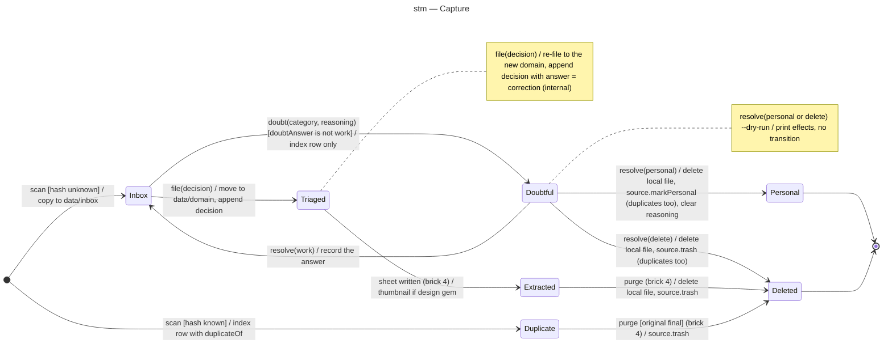

# State machine diagram — triage — Capture

> **Feature**: epic #1, brick #2 (brick 4 transitions drawn so the enum is final, implemented in brick 4)
> **Related ADRs**: ADR-0001 (decision 7 and § Lifecycle), ADR-0002
> **Realises**: UC1, UC2 · **See also**: `02-sequence-triage-batch.md`, `02-sequence-resolve-doubt.md`

## Context

The lifecycle of one capture as recorded in `data/index.jsonl`. The state names, lowercased, are the values of the `status` enum in `src/triage/`; the diagram is the source of truth for the legal transitions and the code must refuse the others. Deletion is an effect of exactly four transitions: two owner answers, the purge after a sheet, and the purge of a duplicate whose original is final.

## Diagram

## Transitions and tests

| From | Event [guard] | To | Effect | Test |
|---|---|---|---|---|
| — | `scan` [hash unknown] | Inbox | copy into `data/inbox/`, row with `contentHash` | T-1 |
| — | `scan` [hash known] | Duplicate | row with `duplicateOf`, no copy | T-2 |
| Inbox | `file(decision)` | Triaged | move to `data/<domain>/<id>.<ext>`, decision appended (skipped if already there), index written, in that order | T-3 |
| Inbox | `doubt(category, reasoning)` [doubtAnswer ≠ work] | Doubtful | index row only, nothing appended to the log | T-4 |
| Doubtful | `resolve(work)` | Inbox | `doubtAnswer = work` on the row; the following `file` logs `answer = work` | T-5 |
| Doubtful | `resolve(personal)` | Personal | local delete, `source.markPersonal` of the capture and its duplicates, reasoning cleared | T-6, T-14 |
| Doubtful | `resolve(delete)` | Deleted | local delete, `source.trash` of the capture and its duplicates | T-6, T-14 |
| Doubtful | `resolve(personal or delete) --dry-run` | Doubtful | effects printed in order, nothing changed | T-7 |
| Triaged | `file(decision)` | Triaged | re-file to another domain folder, decision appended with `answer = correction` | T-8 |
| any other (state, event) pair | — | unchanged | rejected with the current status, non-zero exit | T-10 |
| Triaged | sheet written | Extracted | brick 4 | brick 4 |
| Extracted | purge | Deleted | brick 4 | brick 4 |
| Duplicate | purge [original final] | Deleted | brick 4 | brick 4 |

T-9 (90-day reminder) and T-11 to T-13 belong to UC3 and the tag rules, not to this machine; T-14 (a fresh `scan` after losing the index lists no personal or deleted capture) belongs to the source; see the matrix.

## Notes

- **Rejected events** (T-10 covers one of each): `resolve` on a non-doubtful capture, `file` on a deleted, personal, doubtful or duplicate capture, `doubt` on a triaged capture or on an inbox capture whose `doubtAnswer` is `work`.
- **Personal and Deleted are the final statuses** (glossary "Final status") and never re-enter: a personal capture is never read again (REQ-5); a wrongly deleted asset is restored by the owner in the source trash, outside this tool. The source records both durably, so losing the index never resurfaces them.
- **Duplicate** is reached only from the initial pseudostate: the duplicate file is never copied, so there is nothing local to delete. Its source asset follows its original: marked personal or trashed in the same `resolve` effect list when the original is answered personal or delete, or trashed at the brick 4 purge once the original is purged (the guard `[original final]` keeps the CLAUDE.md invariant).
- The `Inbox → Inbox` case after a failed move (UC1 ext. 5a) is not a transition: the row keeps `inbox` with an `error` field and the next `scan` presents it again.
