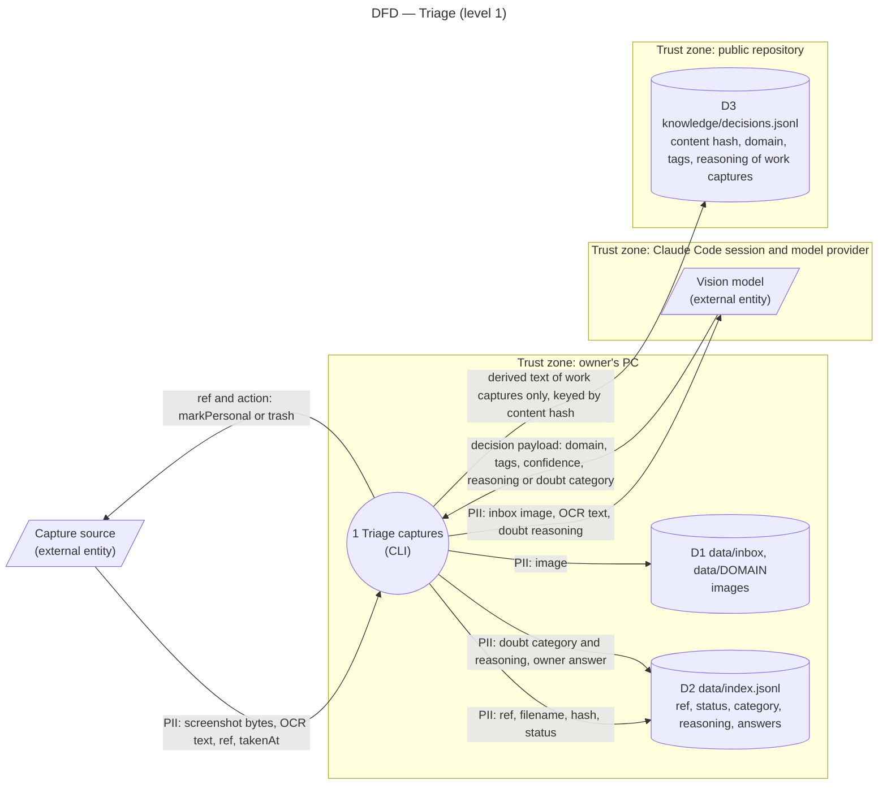

# Data flow diagram — triage — where the captures and their derived text go

> **Feature**: epic #1, brick #2
> **Related ADRs**: ADR-0002, ADR-0005 (global: public repositories)
> **Realises**: REQ-5, NFR-1 · **See also**: `02-sequence-resolve-doubt.md`, `05-state-capture.md`

## Context

Screenshots are personal data by nature (a phone screen) and this repository is public. The diagram shows the one process of the triage step, every store it writes, the two external entities, and the trust boundaries: the PC, the public repository, and the model provider behind the Claude Code session. Flows are labelled with data nouns; `PII:` marks the flows that may carry personal data. Not native UML; drawn as a flowchart.

## Diagram

## Notes

- **Processor**: the model provider receives every inbox image, its OCR text and, in UC2, the doubt reasoning it wrote itself; it never receives a capture after a personal answer. Retention there follows the provider's consumer terms for the Claude Code subscription; nothing in this tool sends a capture twice. Legal basis: the owner's own data, processed on the owner's request.
- **Only D3 is published**: it never holds a ref, a filename, an image, or any text about a capture that was not filed as work (REQ-5, NFR-1). Its key is the content hash, and commands address captures by the 12-character id derived from it, so no filename reaches Git or a shell command.
- **D1 and D2 are git-ignored and unbacked**: losing them loses statuses and doubt answers, never a personal capture, because the source records personal and deleted captures durably (ADR-0002, T-14).
- **What reaches the source**: a ref and an action; no derived text.
- Residual risk: a capture filed as work may still show a third party's name in its OCR text or reasoning; the brick 4 sheet rule "author's handle only" applies to the reasoning as well, and the owner answers `delete` on confidential work content.
