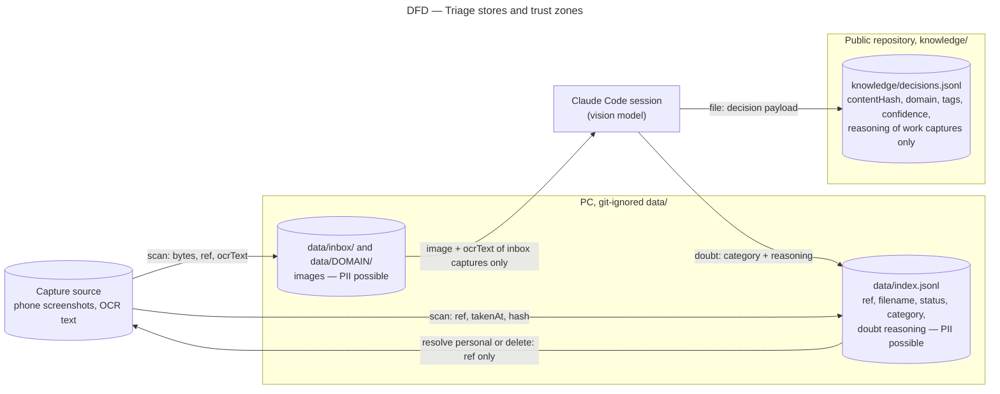

# Data flow diagram — triage — what leaves the PC and what reaches Git

> **Feature**: epic #1, brick #2
> **Related ADRs**: ADR-0002, ADR-0005 (global: public repositories)
> **Realises**: REQ-5, NFR-1 · **See also**: `02-sequence-resolve-doubt.md`, `05-state-capture.md`

## Context

Screenshots are personal data by nature (a phone screen) and this repository is public. The diagram shows every store the triage step writes and flags the one that is published. Not native UML; drawn as a flowchart.

## Diagram

## Notes

- **Only one store is published**: the decision log. It never holds a ref, a filename, an image, or any text about a capture that was not filed as work (REQ-5, NFR-1). Its key is the content hash.
- **The session reads inbox captures only**: a capture answered personal is never sent again; its doubt reasoning is cleared from the index.
- **What reaches the source**: a ref and an action (`markPersonal`, `trash`); no derived text.
- Residual risk: a capture filed as work may still show a third party's name in its OCR text or reasoning; the brick 4 sheet rule "author's handle only" applies to the reasoning as well, and the owner answers `delete` on confidential work content.
